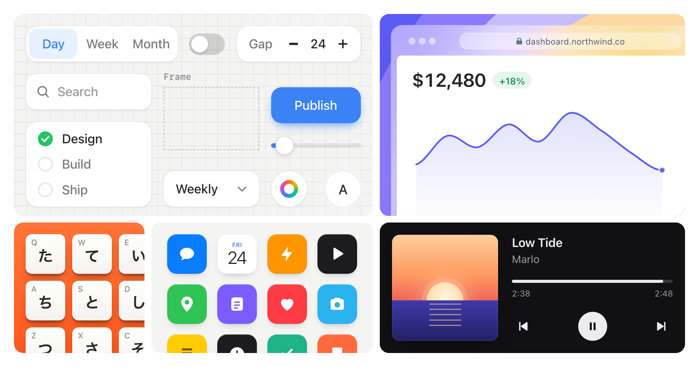

# Skills

Skills I use with coding agents for design and motion work.

## Stageshow



Helps your agent make faux product UI that looks like the real product: stills,
feature cards, cursor demos and bento grids, built in React. It includes guidance
on composition and motion, a kit to copy from, examples, and tools that film the
result so the agent can check its work.

```sh
npx skills add benjitaylor/skills --skill stageshow
```

[How it works](https://benji.org/stageshow) · [Read the skill](stageshow/SKILL.md) · [Preview the examples](stageshow/README.md#preview)

Each skill includes its own licence and any third-party asset notices.
